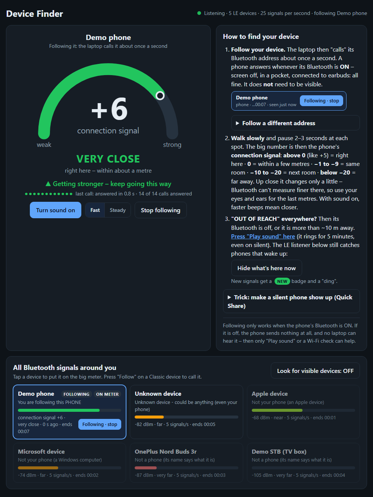

# Device Finder

Find a lost phone nearby using nothing but your Windows laptop's built-in Bluetooth.
A live meter shows how close the phone is, and it keeps working when the phone's
screen is off, it's in a pocket, or it's connected to earbuds.



## How it works

The program talks directly to Windows' own Bluetooth and measures in three ways:

1. **Follow (the main one).** The laptop "calls" the phone's Bluetooth address about
   once a second. A phone answers whenever its Bluetooth is on. It doesn't need to
   be visible or paired. The moment the call connects, Windows measures the signal
   strength of that connection. The program reads it, hangs up at once and calls
   again, so the number keeps moving.
2. **Listen.** Hears Bluetooth LE "advertisements", the short messages many devices
   broadcast, and guesses which ones could be a phone. "Hide what's here now" marks
   anything that appears afterwards with a **NEW** badge and a ding.
3. **Look.** A switch that keeps Windows searching for *visible* (discoverable)
   devices. It's useful the first time, to learn a phone's address.

Every new reading is pushed to the page instantly (Server-Sent Events), so the meter
moves without pressing any buttons.

## Reading the meter

When following a phone, the big number is its **connection signal**:

| Number | Meaning |
|---|---|
| above 0 (like +5) | right here, within about a metre |
| 0 | within a few metres |
| −1 to −9 | same room |
| −10 to −20 | next room |
| below −20 | far away |
| OUT OF REACH | its Bluetooth is off, or it's more than ~10 m away |

These distances are rough guides measured on one laptop. Walls and people change them.
With sound on, faster beeps mean closer.

## What you need

- A Windows laptop with Bluetooth (tested on Windows 11)
- [Python](https://www.python.org/downloads/) 3.10 or newer (tested with 3.13)

## Setup (once)

1. Download this project (green **Code** button → **Download ZIP**) and unzip it.
2. Open a Command Prompt in that folder and run:

   ```
   py -m venv .venv
   .venv\Scripts\python.exe -m pip install -r requirements.txt
   ```

## Run it

Double-click **Device Finder.bat**. A black Command Prompt window opens: keep it
open, because closing it stops Device Finder. It opens in your browser at
http://127.0.0.1:8765/.

To try it without any Bluetooth devices, use the demo mode with pretend devices:

```
.venv\Scripts\python.exe device_finder.py --demo
```

Other options: `--no-browser`, `--seconds N` (stop after N seconds), `--port N`.

## First time: teach it your phone

Device Finder needs your phone's Bluetooth address once. Either:

- switch on **Look for visible devices**, then open the Bluetooth settings on your
  phone (that makes it visible for a while). It appears under step 1 with a
  **Follow** button; or
- type the address under **Follow a different address**. On Android it's usually
  under Settings → About phone → Status.

Phones are remembered in `phones.json` on your own computer. That file is never
uploaded. If exactly one phone is remembered, Device Finder starts following it by itself.

## Good to know

- Following only works while the phone's Bluetooth is **on**. With Bluetooth off, a
  phone sends nothing at all. Then use Google's Find Hub "Play sound" instead.
- Up close (within a few metres) the number changes only a little, because Bluetooth
  can't measure finer than that. Use your eyes and ears for the last metres.
- The Look search pauses while following, because both write into the same place
  in Windows and would mix up the readings.
- Tested with a POCO M2 (Android). The Listen guesses know POCO, Redmi and Xiaomi
  names; Follow works from the address alone.
- Only use it to find your own devices.

## Files

| File | What it is |
|---|---|
| `device_finder.py` | The program: Bluetooth listening and calling, plus a small web server for the page |
| `device_finder.html` | The page with the meter |
| `Device Finder.bat` | Double-click to start |
| `requirements.txt` | The Python packages it needs |
| `screenshot.png` | The picture above |
